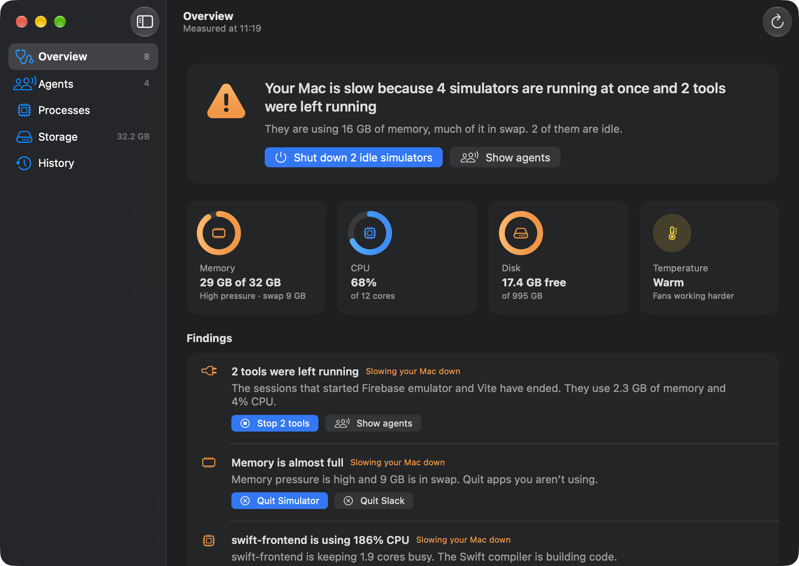
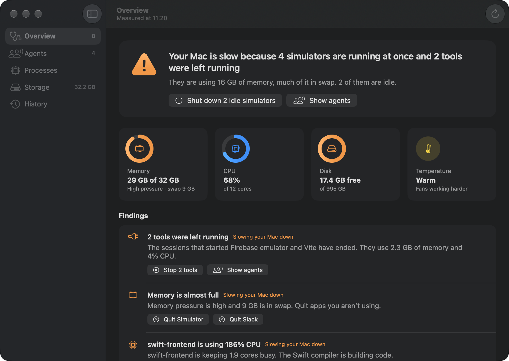
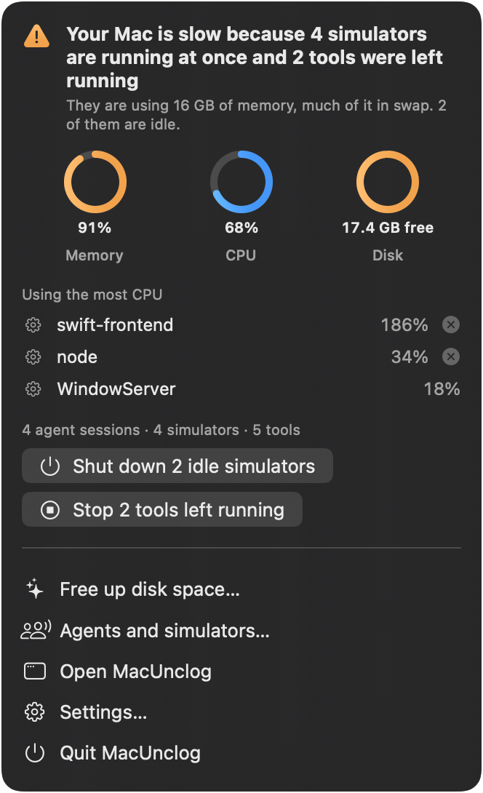
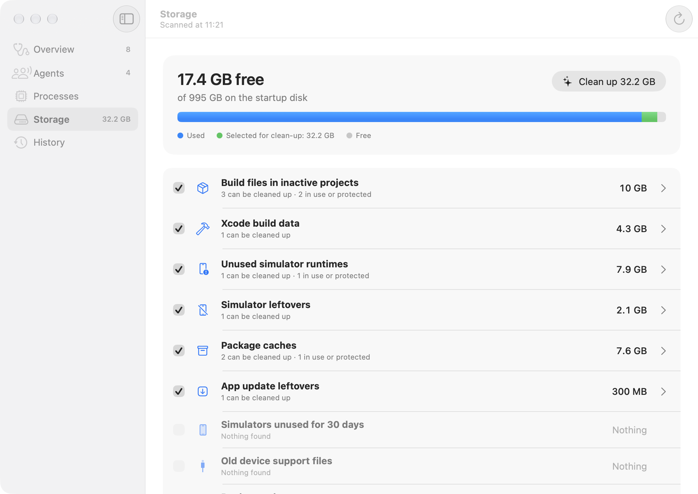

<p align="center"></p>

<h1 align="center">MacUnclog</h1>

<p align="center">
  <a href="https://github.com/anderskraken/macunclog/actions/workflows/build.yml"></a>
  <a href="LICENSE"></a>
</p>

MacUnclog tells you why your Mac is slow and fixes it in one click. It is built for Macs where coding agents (Claude Code, Codex) run in many worktrees at once and leave simulators, dev servers and build output behind.



## What it does

- **Diagnoses in seconds.** Memory pressure, swap, processes that keep the CPU busy (a short spike doesn't count), apps that have stopped responding, low disk space, thermal throttling and Low Power Mode. You get one verdict, such as "Your Mac is slow because 7 simulators are running at once", with buttons to fix it.
- **Shows what agents are running.** Each Claude and Codex session with its project or worktree, the simulators that are booted, and the dev servers, emulators and builds each session started.
- **Stops what nobody uses.** Shuts down idle simulators and stops dev servers and tools that an agent left running after its session ended. It never touches a session, anything a running session owns, or anything it can't trace to an agent.
- **Frees disk space safely.** Removes caches and build output, but only from projects that are idle and only after checking that nothing has the files open.
- **Finds big files and old installers.** Disk images, installer packages and files over 500 MB in your own folders, which you can move to the Bin. It never moves them on its own and never empties the Bin.
- **Cleans up on its own, if you want.** A background agent can clean up when free space drops below a limit you set or on a schedule, and tells you what it did. It's off until you turn it on in Settings.

It lives in a window and in the menu bar, and adds a "Why is my Mac slow?" action to Shortcuts. It stays light itself: a measurement takes about 0.2 CPU seconds, every 10 seconds while you look at it and every 30 seconds when its window is closed or covered.



<p align="center"></p>

## What each cleanup removes

| Category | Removes | Skips it when |
|---|---|---|
| Build output in idle projects | `node_modules`, `target`, `.next`, `.turbo`, `.svelte-kit`, `.nuxt`, `.parcel-cache`, `.build`, Gradle `build` and Xcode `DerivedData` (including `.ios*/dd-*`) inside projects and `.claude/worktrees` | The folder isn't git-ignored, the project isn't a git repository, anything in it changed or was committed in the last 3 days, a process works in it or has a file open there, another active project links to it, something outside uses it (a symlink in a `bin` folder, a global npm link (including the default nvm, fnm, mise and Volta folders), an MCP server in an agent's config or a project's `.mcp.json`, a LaunchAgent), or it's on another volume. If one of those configs can't be read, MacUnclog leaves the affected projects alone (all of them, for a global config) |
| Xcode build data | Folders in `~/Library/Developer/Xcode/DerivedData`, SwiftUI previews, Xcode's cache | The project was opened or built in the last 3 days, or a file in it is open |
| Unused simulator runtimes | Runtimes, via `xcrun simctl runtime delete` | A simulator uses it: in the default set, test clones, Xcode previews, Playgrounds, or a project's own device set (a `device_set.plist` under your project folders). Device-specific runtimes count too. Nothing is offered if the device list can't be read |
| Simulator leftovers | Unavailable simulators, test clones, the CoreSimulator cache | The simulator is booted, a test clone is in use, or (for the cache) any simulator is running |
| Simulators unused for 30 days | The whole simulator, via `xcrun simctl delete`. Off in automatic cleanup | It's running or was used recently |
| Old device support files | Older versions in `iOS DeviceSupport` and similar. The newest per platform stays | It changed recently |
| Package caches | npm, pnpm, Yarn, Bun, Gradle, CocoaPods, Playwright, Homebrew, SwiftPM, Go, pip, uv, Cargo, node-gyp and Electron download caches | A process has a file open in it |
| App update leftovers | ShipIt and Sparkle downloads in `~/Library/Caches` | An update is in progress |
| Docker cache | `docker builder prune` and `docker image prune` (untagged images only) | Docker isn't running, or the context or build cache belongs to another machine. MacUnclog never starts Docker |

It never empties the Bin and never deletes Xcode archives, Docker volumes or containers. Automatic clean-up starts with caches, Xcode data, simulator leftovers and unused runtimes; build output, Docker and whole simulators only join if you tick them in Settings.

**Your files** lists disk images and installers (`.dmg`, `.pkg`, `.mpkg`, `.iso`, `.xip`) and files of 500 MB or more in your home folder. It finds them with Spotlight and also looks in Downloads, Desktop and the home folder itself. It skips `~/Library`, hidden folders, git projects, build folders, apps, Photos, Music, Final Cut Pro, iMovie and Lightroom libraries, files iCloud keeps only online, files with more than one hard link, open files and your protected folders. A copy that Finder duplicated shares its space with the original, so the space freed can be less than the size shown. Nothing is ticked until you tick it, and Move to Bin asks first.



## Safety rules

1. **Check what's in use first.** One `lsof` pass reads the working folders, open files and running binaries of every process. If `lsof` fails, everything counts as in use.
2. **Check again right before deleting.** MacUnclog scans the selected categories again and reads open files again (every 15 seconds during a long run). It skips anything that came into use.
3. **Never delete a runtime a simulator needs.** Every device set MacUnclog can find counts. If the search fails, MacUnclog offers no runtimes.
4. **Never touch your data.** Every deletion goes through `PathGuard`. It refuses anything outside your home folder, anything on another volume and anything under Documents, Desktop, Downloads, Pictures, Movies, Music, iCloud Drive, app containers, Mail, Messages, keychains, `~/.ssh` and agent history. `PathGuard` resolves symlinks before it checks. You can add your own protected folders in Settings. The one exception is a file you tick under Your files: MacUnclog moves it to the Bin, after checking again that it hasn't changed and isn't open.
5. **Only stop what an agent left behind.** A tool counts as left running only when its environment shows an agent started it and that session has ended. Claude Code sets `CLAUDECODE` and `CLAUDE_PID`, so MacUnclog checks that exact session. Codex sets no session ID, so a Codex tool only counts while no Codex session is running at all. Tools started from a terminal, an IDE or a service manager are left alone, and stopping several at once asks first.
6. **One clean-up at a time.** The app, its timer and the background agent share a lock, and the agent cleans at most every six hours for low space and warns at most once a day that space is still low.

MacUnclog deletes files and stops processes. Tests cover the rules above, but it comes with no warranty (see the licence). Run `--scan` first to see what it would delete on your Mac.

## Build and run

You need macOS 26 or later and Xcode 26 or later.

```bash
xcodebuild -project MacUnclog.xcodeproj -scheme MacUnclog -configuration Release -derivedDataPath build/dd build
open build/dd/Build/Products/Release/MacUnclog.app
```

The project signs to run locally, so no Apple team is needed. To sign with your own team, add `Configs/Local.xcconfig` with `DEVELOPMENT_TEAM` and `CODE_SIGN_IDENTITY` (see `Configs/Signing.xcconfig`).

The background agent needs a build signed with a team; a free Personal Team works. macOS won't start a launch agent from a build that only signs to run locally. In that case MacUnclog runs the same check itself every 15 minutes while the app is open.

The app isn't sandboxed, because it runs `lsof`, `ps` and `xcrun simctl` and deletes from `~/Library`.

Run the tests:

```bash
xcodebuild -project MacUnclog.xcodeproj -scheme MacUnclog -derivedDataPath build/dd test
```

The tests create real git projects and processes under `~/Library/Caches/MacUnclogTests-*` and remove them again.

`MacUnclog.xcodeproj` is generated from `project.yml` with [XcodeGen](https://github.com/yonaskolb/XcodeGen). Run `xcodegen generate` after adding or removing files.

### Command line

The app binary also works from the terminal:

```bash
MacUnclog.app/Contents/MacOS/MacUnclog --help
```

- `--diagnose` prints the verdict, the findings, agent sessions, simulators and tools. `--for 15` measures for 15 seconds, so a process that keeps the CPU busy counts as lasting and not as a spike.
- `--scan [category …]` shows what would be cleaned. It deletes nothing.
- `--files` lists installers and large files. It moves nothing.
- `--skill [install|remove] [claude|codex]` shows, installs or removes the agent skill (see below).
- Add `--json` to `--diagnose`, `--scan` or `--files` for output that scripts and agents can read. Kinds, severities and reasons are fixed identifiers; titles follow your Mac's language.
- `--agent --dry-run` shows what the background agent would clean now.
- `--automation on|off` turns automatic cleanup and the background agent on or off.
- `--benchmark [N]` measures N diagnoses and prints wall time, CPU time and memory.
- `--act quit|forceQuit|pause|resume PID`, `--act stop-tool PID` and `--act shutdown-simulator UDID` do what the buttons do, with the same checks.

### Use it from Claude Code or Codex

`skills/macunclog` is a skill that tells an agent to check the Mac before it boots a simulator or starts a big build, to shut down idle simulators and stop tools left behind by ended sessions, and to ask you before anything else. Install it under Settings > Coding agents, or from the terminal:

```bash
MacUnclog.app/Contents/MacOS/MacUnclog --skill install
```

That installs it for each of Claude Code and Codex that is set up on the Mac (`--skill install claude` or `codex` for one). `--skill` alone shows whether it's installed, and `--skill remove` removes it. If the app isn't in `/Applications`, the installed skill points at the copy that installed it.

## How it's built

| Folder | Contents |
|---|---|
| `MacUnclog/Probes` | Measurements: memory, CPU, disk, temperature, battery and processes (`SystemProbe`), agents and simulators (`AgentProbe`), process and agent actions |
| `MacUnclog/Model` | The verdict rules (`VerdictEngine`), who owns which tool (`AgentLoadBuilder`), what may be quit (`ProcessPolicy`) |
| `MacUnclog/Cleanup` | Categories, scanners, the installer and large-file finder (`PersonalFiles`), `PathGuard`, the `lsof` snapshot, one shared walk of the project folders (`ProjectIndex`), the simulator inventory and the executor |
| `MacUnclog/Automation` | The launchd agent, settings, history and notifications |
| `MacUnclog/Views` | SwiftUI views for the window, the menu bar and Settings |

Notes:

- "Not responding" detection uses the same window server flag as Force Quit. There is no public API for it, so MacUnclog looks the function up at runtime and treats apps as responding if it's missing.
- CPU for system processes comes from `ps`, because macOS only lets an app read its own processes directly.
- History is one JSON file per cleanup in `~/Library/Application Support/MacUnclog/History`.

The icon was generated with OpenAI's image model through the Codex CLI. The prompts are in `design/icon/prompt.md`. It's offered under the same terms as the code, without any claim of copyright in it.

## Contributing

Issues and pull requests are welcome; see [CONTRIBUTING.md](CONTRIBUTING.md). Report a bug that deleted or stopped something it shouldn't have as described in [SECURITY.md](SECURITY.md).

## Licence

MIT. See [LICENSE](LICENSE).
